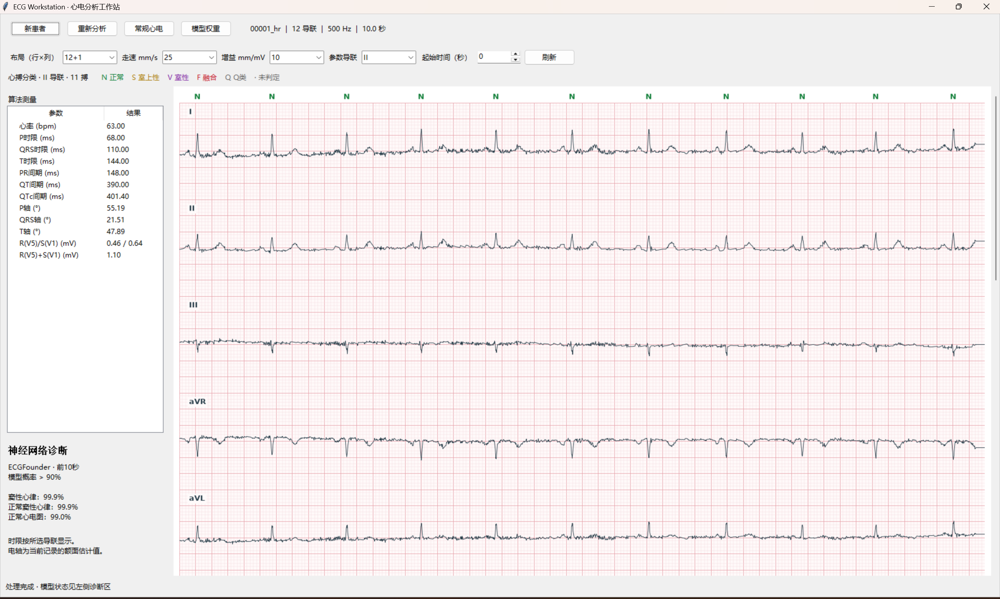

# ECG Workstation

Windows 心电工作站。支持 WFDB `.hea` 记录导入、12 导联心电纸显示、心搏分类与波形参数测量。



1. 从 GitHub Releases 下载 Windows x64 ZIP，完整解压到本地目录。
2. 双击 `ECGWorkstation.exe`，点击「新患者」选择 `.hea`。请把 `.hea` 和头文件引用的波形文件放在一起。
3. 默认显示 12+1 布局和 10 秒窗口，可切换布局、走速、增益和起始时间。
4. N/S/V/F/Q 心搏分类所用的 CPU 模型已随包提供。若要启用 ECGFounder，需从[模型官方页面](https://huggingface.co/PKUDigitalHealth/ECGFounder/tree/main)下载 `12_lead_ECGFounder.pth`，再通过「模型权重」选择该文件。

用于算法研究和结果复核。模型输出和自动测量未经本工作站的临床验证。

## 从源码运行和打包

在 Windows x64 的 Python 3.12 环境中运行以下命令：

```powershell
python -m venv .venv
.\.venv\Scripts\python.exe -m pip install torch==2.7.1 --index-url https://download.pytorch.org/whl/cpu
.\.venv\Scripts\python.exe -m pip install -r requirements-windows.txt
.\.venv\Scripts\python.exe ecg_workstation.py
```

构建 Windows 目录包时，先安装 `pyinstaller==6.22.3`，再运行 `./build-windows.ps1 -Python ./.venv/Scripts/python.exe`。可执行文件与 `_internal` 必须一起分发。

许可证见根目录和 `vendor` 内随附的许可及声明。心搏模型来自 [haliidm 的心搏分类项目](https://github.com/haliidm/mitbih-heartbeat-classification)，ECGFounder 模型结构与标签来自 [PKUDigitalHealth/ECGFounder](https://github.com/PKUDigitalHealth/ECGFounder)。
